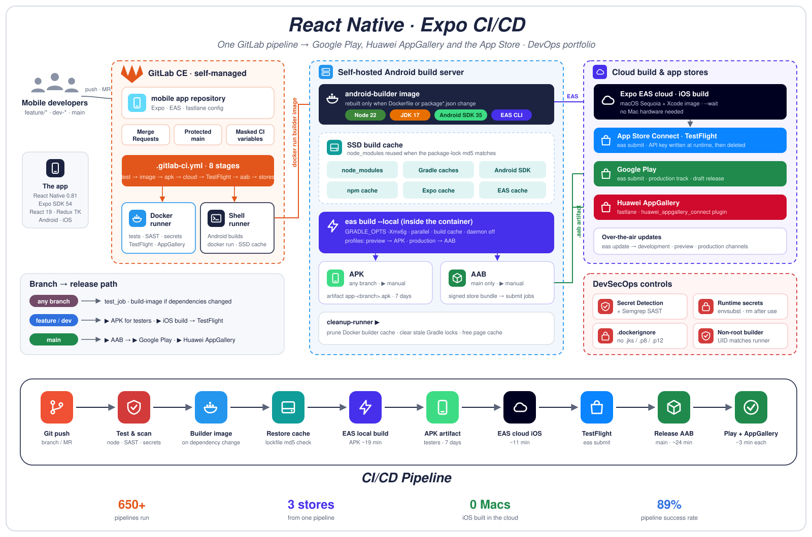
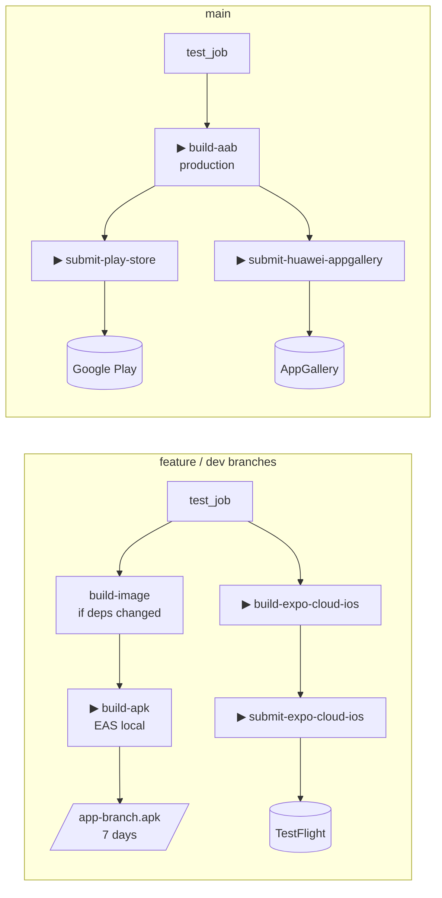
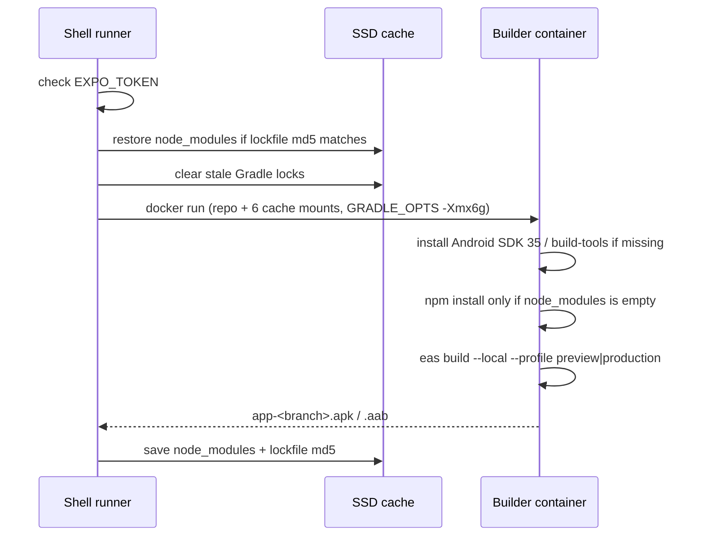
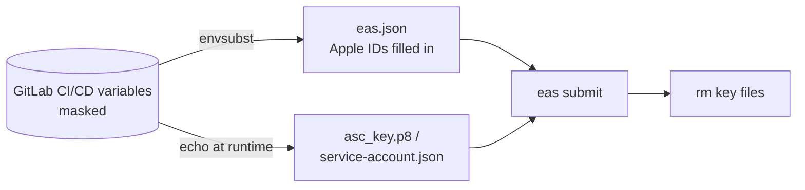

# React Native · Expo CI/CD


The GitLab CI/CD pipeline I built and run for a production **React Native / Expo** app. One pipeline ships the app to **Google Play, Huawei AppGallery and the Apple App Store**:

- **Android** builds run on our own server, inside a Docker builder image with an SSD cache.
- **iOS** builds run in Expo EAS cloud, so no Mac is needed.



> This repository is a sanitized portfolio copy. It contains **only the CI/CD tooling**. The app's source code, name, bundle ID, Expo project ID and every credential are left out. All secrets live in GitLab CI/CD variables.

---

## Highlights

- **Three stores, one pipeline.** `main` produces a signed AAB that goes to Google Play (`eas submit`) and Huawei AppGallery (fastlane). iOS builds in EAS cloud and goes to TestFlight.
- **Self-hosted Android builds.** `eas build --local` runs inside a purpose-built image (Node 22, JDK 17, Android SDK 35, EAS CLI). This avoids EAS build queues and per-build cost.
- **SSD build cache.** `node_modules` is reused when the `package-lock.json` md5 matches. Gradle, Android SDK, npm, Expo and EAS caches are bind-mounted into every build.
- **Builder image rebuilt only when needed.** `build-image` runs only when `Dockerfile`, `package.json` or `package-lock.json` change.
- **Secrets never touch git.** `eas.json` holds `$PLACEHOLDERS`; `envsubst` fills them in during the job. Key files (`asc_key.p8`, `service-account.json`) are written at runtime and deleted afterwards. `.dockerignore` keeps `*.jks`, `*.p8`, `*.p12` and `*.key` out of the image.
- **DevSecOps.** GitLab Secret Detection and Semgrep SAST run on feature branches. The builder runs as a non-root user whose UID matches the runner.
- **DRY pipeline.** Shared YAML snippets for the token check, cache restore/save and Gradle lock cleanup. One `.android_local_build` template powers the APK, clean-cache APK and AAB jobs.

## Results

| Metric | Value |
|---|---|
| Pipelines run | 650+ |
| Pipeline success rate | ~89% |
| Stores published to | 3 (Google Play, AppGallery, App Store) |
| Android APK build (cached) | ~19 min |
| Android AAB release build | ~24 min |
| iOS cloud build | ~11 min |
| Store submission | ~3 min (Play, AppGallery) |

---

## Pipeline



| Stage | Job | Runner | When |
|---|---|---|---|
| test | `test_job` | docker | every branch |
| test | `semgrep-sast`, `secret_detection` | docker | manual, non-`main` |
| build-image | `build-image` | shell | automatic when deps change |
| build-apk | `build-apk`, `build-apk(clear-cache)` | shell | manual, non-`main` |
| cleanup | `cleanup-runner` | shell | manual |
| build-expo-cloud | `build-expo-cloud-ios` | shell | manual, non-`main` |
| deploy-TestFlight | `submit-expo-cloud-ios` | docker | manual |
| build-aab | `build-aab` | shell | manual, `main` |
| submit-store | `submit-play-store`, `submit-huawei-appgallery` | shell / docker | manual, `main` |

## How a local Android build works



## How secrets are handled



---

## Repository layout

```text
.
├── .gitlab-ci.yml      # the pipeline
├── Dockerfile          # Android builder image (Node 22, JDK 17, EAS CLI, non-root user)
├── .dockerignore       # keeps signing keys and caches out of the image
├── eas.json            # build profiles + submit config with $PLACEHOLDERS only
├── Gemfile             # fastlane + Huawei AppGallery plugin
├── fastlane/
│   └── Fastfile        # huawei_upload lane
└── assets/
    └── architecture.svg
```

In the real project these files sit next to the Expo app (`App.jsx`, `app.json`, `src/`, `package.json`).

## EAS build profiles

| Profile | Distribution | Android output | Used by |
|---|---|---|---|
| `development` | internal | APK (dev client) | developers |
| `preview` | internal | APK | `build-apk` |
| `preproduction` | internal | APK | QA |
| `production` | store | AAB / iOS archive | `build-aab`, `build-expo-cloud-ios` |

## CI/CD variables

| Variable | Purpose |
|---|---|
| `EXPO_TOKEN` | EAS authentication (protected, masked) |
| `CACHE_DIR` | SSD path for build caches on the runner |
| `APPLE_ID`, `APPLE_TEAM_ID`, `ASC_APP_ID` | Injected into `eas.json` for App Store submit |
| `ASC_KEY_ID`, `ASC_ISSUER_ID`, `ASC_PRIVATE_KEY` | App Store Connect API key |
| `GOOGLE_SERVICE_ACCOUNT_JSON` | Google Play publishing service account |
| `HUAWEI_CLIENT_ID`, `HUAWEI_CLIENT_SECRET`, `HUAWEI_APP_ID` | AppGallery Connect API |
| `ANDROID_KEYSTORE_BASE64`, `ANDROID_KEYSTORE_PASSWORD`, `ANDROID_KEY_ALIAS`, `ANDROID_KEY_PASSWORD` | Upload keystore |

## Tech stack

GitLab CE · GitLab Runner (shell + docker) · Docker · React Native 0.81 · Expo SDK 54 · EAS Build / Submit / Update · Node.js 22 · OpenJDK 17 · Gradle · Android SDK 35 · fastlane · Semgrep · GitLab Secret Detection

## What I'd add next

- Run `jest` and ESLint in `test_job` and block merges on failure.
- Pin `eas-cli` and the base images to exact versions, with Renovate opening update MRs.
- Move Android builds to a dedicated runner VM with its own disk for caches.
- Automate version and `runtimeVersion` bumps from git tags.
- Promote Play releases from `draft` to staged rollout via the pipeline.

---

**Author:** Mohamed Alshaibani · DevOps Engineer
